# My Windows 11 Setup

A complete guide to my Windows 11 customization: a tiling window manager, a custom status bar, a pastel **Catppuccin Mocha** terminal, and all the little tweaks that make it clean and productive.

<div align="center">
  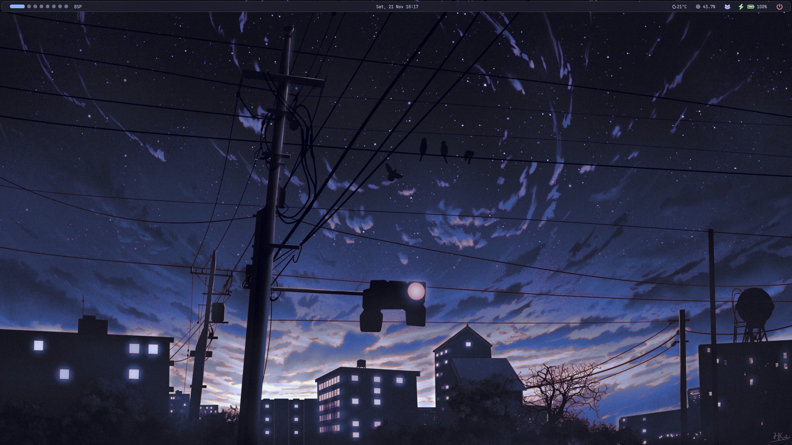
</div>

## 📄 Table of Contents

- [Gallery](#-gallery)
- [What's in this setup](#-whats-in-this-setup)
- [Quick install](#-quick-install-recommended)
- [Manual installation](#-manual-installation)
- [Keybindings](#-keybindings)
- [Terminal visuals (clock and rain)](#-terminal-visuals-clock-and-rain)
- [Windows tweaks](#-windows-tweaks)
- [Startup automation](#-startup-automation)
- [Color palette](#-color-palette)
- [Repo structure](#-repo-structure)
- [Updating this repo](#-updating-this-repo)
- [Troubleshooting](#-troubleshooting)
- [Credits](#-credits--helpful-resources)

---

## 🖼️ Gallery

<div align="center">
  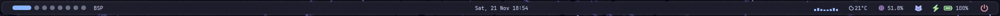
  <br><sub>YASB status bar</sub>
</div>

### Tiling layouts (Komorebi)

<div align="center">
  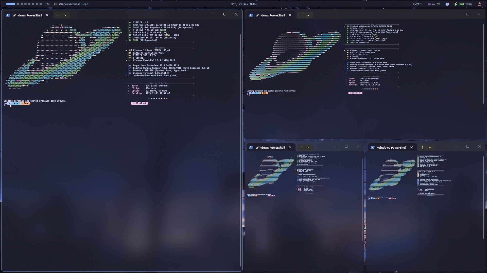
  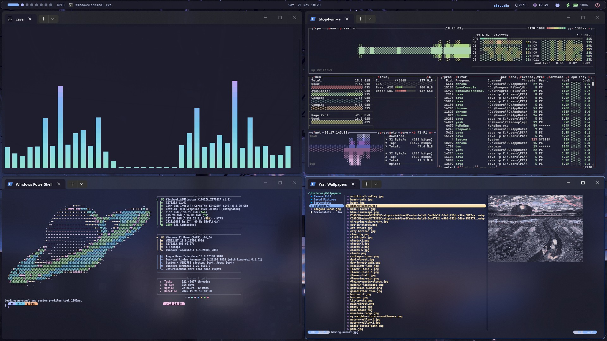
  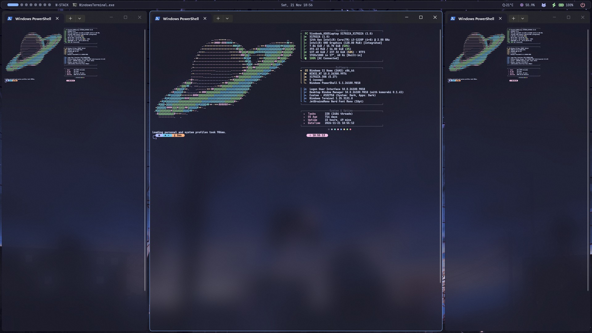
  <br><sub>BSP &nbsp;·&nbsp; Grid &nbsp;·&nbsp; Ultrawide stack (W-STACK)</sub>
</div>

### YASB popups

<div align="center">
  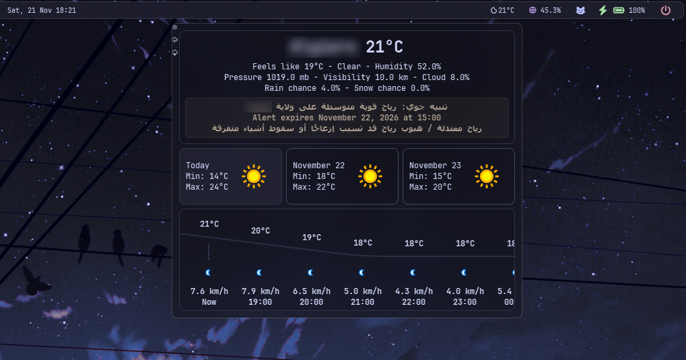
  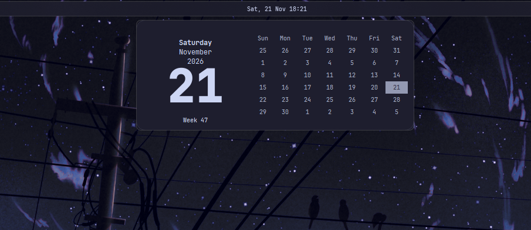
  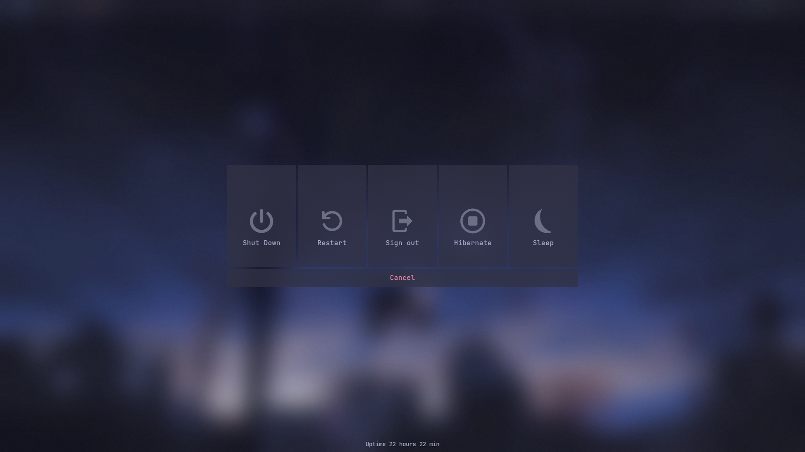
  <br><sub>Weather &nbsp;·&nbsp; Calendar &nbsp;·&nbsp; Power menu</sub>
</div>

### Wallpapers, launcher and terminal

<div align="center">
  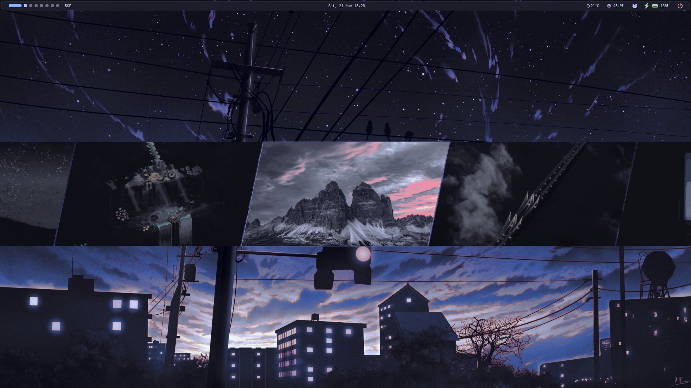
  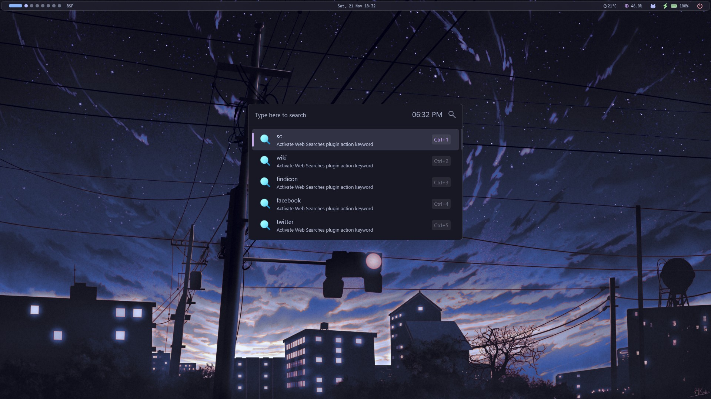
  <br><sub>Wallpaper gallery (<code>Alt + W</code>) &nbsp;·&nbsp; Flow Launcher (<code>Alt + Space</code>)</sub>
  <br><br>
  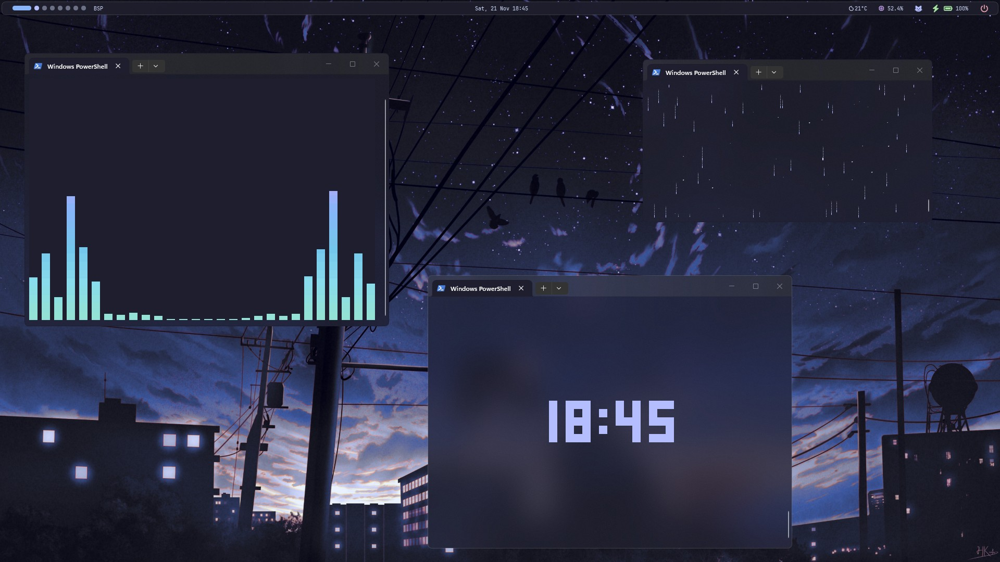
  <br><sub>Cava, the terminal clock and the rain animation</sub>
</div>

---

## ✨ What's in this setup

| 🏷️ Name | ✨ Source | 📦 Installed with |
| :--- | :--- | :--- |
| Status Bar | [YASB](https://github.com/amnweb/yasb) | Scoop (`extras`) |
| Window Manager | [Komorebi](https://github.com/LGUG2Z/komorebi) | Scoop (`extras`) |
| Hotkey Daemon | [whkd](https://github.com/LGUG2Z/whkd) | Scoop (`extras`) |
| Focus Follows Mouse | [Masir](https://github.com/LGUG2Z/masir) | winget |
| App Launcher | [Flow Launcher](https://github.com/Flow-Launcher/Flow.Launcher) | winget |
| Terminal | [Windows Terminal](https://github.com/microsoft/terminal) | winget |
| Prompt | [Oh My Posh](https://ohmyposh.dev/) | winget |
| System Info | [Fastfetch](https://github.com/fastfetch-cli/fastfetch) | winget |
| File Manager (TUI) | [Yazi](https://github.com/sxyazi/yazi) | winget |
| System Monitor (TUI) | [btop4win](https://github.com/aristocratos/btop4win) | Manual (GitHub release) |
| Audio Visualizer | [Cava](https://github.com/karlstav/cava) | winget |
| Fuzzy Finder | [fzf](https://github.com/junegunn/fzf) | winget |
| File Finder | [fd](https://github.com/sharkdp/fd) | winget |
| Smarter `cd` | [zoxide](https://github.com/ajeetdsouza/zoxide) | winget |
| Fast grep | [ripgrep](https://github.com/BurntSushi/ripgrep) | winget |
| Text Editor | [VSCode](https://code.visualstudio.com/) | winget |
| Font | [JetBrainsMono Nerd Font](https://www.nerdfonts.com/) | Oh My Posh / manual |
| Mouse Cursors | [Windows 11 Cursors Concept](https://vsthemes.org/en/cursors/black/36701-windows-11-cursors-concept.html) | Manual |
| Theme | [Catppuccin Mocha](https://github.com/catppuccin/catppuccin) | Config files |

Yazi's optional helpers (`7zip`, `ffmpeg`, `jq`, `fd`, `ripgrep`, `fzf`, `zoxide`, `ImageMagick`) are installed too, so previews and search work properly.

**Optional extras** I also use: [TranslucentTB](https://github.com/TranslucentTB/TranslucentTB), [Windhawk](https://windhawk.net/), and [Win11 Toggle Rounded Corners](https://github.com/rich-ayr/win11-toggle-rounded-corners).

---

## 🚀 Quick install (recommended)

> [!WARNING]
> Read the scripts before running them, and back up your own configs first. The installer makes a `.bak` copy of every file it replaces.

Run in a **normal** (non-admin) PowerShell window:

```powershell
git clone https://github.com/YOUR_USERNAME/My-Win11-Setup.git
cd My-Win11-Setup
powershell -ExecutionPolicy Bypass -File .\install.ps1
```

Add `-Extras` to also install TranslucentTB and Windhawk:

```powershell
powershell -ExecutionPolicy Bypass -File .\install.ps1 -Extras
```

The script:

1. Installs **Scoop** (if missing), adds the `extras` bucket, and installs `git`, `7zip`, `komorebi`, `whkd` and `yasb`
2. Installs the **winget** apps listed above
3. Installs the **JetBrainsMono Nerd Font**
4. Copies every config to the right folder, replacing `C:\Users\PC` inside the files with **your** user folder
5. Downloads Komorebi's application rules (`komorebic fetch-asc`)

Then do the few manual steps:

1. Open `%USERPROFILE%\.config\yasb\config.yaml` and set your **weather API key** and **wallpapers folder**
2. Install [btop4win](#5%EF%B8%8F%E2%83%A3-btop4win) (manual)
3. In Flow Launcher: Settings → Theme → select **Catppuccin_Mocha** (or **Tokyo Night Dark**)
4. Restart your terminal, then run `.\start-wm.ps1`

---

## 🛠️ Manual installation

Prefer to do it step by step? Here is everything the script does.

### 1️⃣ Scoop

[Scoop](https://scoop.sh/) is a command-line installer. Run in a normal PowerShell window:

```powershell
Set-ExecutionPolicy -ExecutionPolicy RemoteSigned -Scope CurrentUser
Invoke-RestMethod -Uri https://get.scoop.sh | Invoke-Expression

scoop install git 7zip
scoop bucket add extras
```

### 2️⃣ Komorebi + whkd + YASB (Scoop)

```powershell
scoop install extras/komorebi extras/whkd extras/yasb
```

### 3️⃣ Everything else (winget)

```powershell
winget install --id LGUG2Z.masir -e
winget install --id Flow-Launcher.Flow-Launcher -e
winget install --id Microsoft.WindowsTerminal -e
winget install --id JanDeDobbeleer.OhMyPosh -e
winget install --id Fastfetch-cli.Fastfetch -e
winget install --id karlstav.cava -e
winget install --id sxyazi.yazi -e
winget install --id junegunn.fzf -e
winget install --id sharkdp.fd -e
winget install --id ajeetdsouza.zoxide -e
winget install --id BurntSushi.ripgrep.MSVC -e
winget install --id jqlang.jq -e
winget install --id Gyan.FFmpeg -e
winget install --id ImageMagick.ImageMagick -e
winget install --id Microsoft.VisualStudioCode -e
```

Close and reopen the terminal after installing so the new commands are found.

### 4️⃣ Nerd Font

The terminal uses **JetBrainsMono Nerd Font Mono** and YASB uses **JetBrainsMono NFP**. Both come from the same font package.

```powershell
oh-my-posh font install JetBrainsMono
```

Or download `JetBrainsMono.zip` from [nerdfonts.com](https://www.nerdfonts.com/font-downloads), select all the `.ttf` files, right-click → **Install**.

### 5️⃣ btop4win

Download the latest release from [btop4win releases](https://github.com/aristocratos/btop4win/releases), extract it to `%LOCALAPPDATA%\Programs\btop4win`, and add that folder to your user `PATH`. Then run `btop`.

### 6️⃣ Komorebi + whkd + Masir

> [!NOTE]
> Masir enables "focus follows mouse" so it works smoothly with Komorebi's tiling.

```powershell
# Komorebi config -> your user folder
Copy-Item .\Komorebi\komorebi.json "$env:USERPROFILE\komorebi.json"

# whkd shortcuts -> .config
New-Item -ItemType Directory -Force "$env:USERPROFILE\.config" | Out-Null
Copy-Item .\Komorebi\whkdrc "$env:USERPROFILE\.config\whkdrc"

# Download Komorebi's per-app rules (applications.json)
komorebic fetch-asc
```

`komorebi.json` points to `C:/Users/PC/applications.json`. **Change `PC` to your own username** (the quick installer does this for you).

Start everything:

```powershell
komorebic start --whkd
masir
```

Stop with `komorebic stop --whkd`.

### 7️⃣ YASB (status bar)

> [!NOTE]
> Some stuff in my config might not work if you just copy and paste it. Be sure to add your own API key for the weather widget to work, and update your folder paths.

```powershell
New-Item -ItemType Directory -Force "$env:USERPROFILE\.config\yasb" | Out-Null
Copy-Item .\YASB\config.yaml "$env:USERPROFILE\.config\yasb\config.yaml"
Copy-Item .\YASB\styles.css  "$env:USERPROFILE\.config\yasb\styles.css"
```

Then edit `config.yaml`:

| Setting | What to change |
| :--- | :--- |
| `weather` → `api_key` | Your free key from [weatherapi.com](https://www.weatherapi.com/) |
| `weather` → `location` | Your city |
| `wallpapers` → `image_path` | Your wallpapers folder |

Start the bar with `yasbc start`, or reload it with `yasbc reload` (it also watches the config and stylesheet for changes).

**Bar layout:**

| Left | Center | Right |
| :--- | :--- | :--- |
| Komorebi workspaces, active layout, active window | Clock | Cava, weather, RAM, wallpapers, battery, power menu |

Press `Alt + W` to open the wallpaper gallery.

### 8️⃣ Windows Terminal

Back up your current file, then copy mine:

```powershell
$dest = "$env:LOCALAPPDATA\Packages\Microsoft.WindowsTerminal_8wekyb3d8bbwe\LocalState"
Copy-Item "$dest\settings.json" "$dest\settings.json.bak"
Copy-Item .\Terminal\settings.json "$dest\settings.json"
```

Highlights: Catppuccin Mocha color scheme, acrylic background at 65% opacity, JetBrainsMono Nerd Font Mono, Windows PowerShell as the default profile.

### 9️⃣ PowerShell profile, Oh My Posh and Fastfetch

The profile sets UTF-8, shows Fastfetch when the terminal opens, and loads the Oh My Posh prompt.

```powershell
$docs = [Environment]::GetFolderPath('MyDocuments')
New-Item -ItemType Directory -Force "$docs\WindowsPowerShell" | Out-Null
Copy-Item .\PowerShell\Microsoft.PowerShell_profile.ps1 "$docs\WindowsPowerShell\Microsoft.PowerShell_profile.ps1"

New-Item -ItemType Directory -Force "$env:USERPROFILE\.config\oh-my-posh","$env:USERPROFILE\.config\fastfetch" | Out-Null
Copy-Item .\OhMyPosh\catppuccin_mocha.omp.json "$env:USERPROFILE\.config\oh-my-posh\"
Copy-Item .\Fastfetch\* "$env:USERPROFILE\.config\fastfetch\"
```

The profile and the Fastfetch config contain paths like `C:/Users/PC/...`. **Replace `PC` with your username** (the quick installer does this for you).

> This profile is for **Windows PowerShell 5.1** (`Documents\WindowsPowerShell`). For PowerShell 7 the profile folder is `Documents\PowerShell`.

**What the prompt shows:** OS icon, current folder, git branch (only inside a repo), how long the last command took, a clock on the right, and a `❯` that turns red when the last command failed.

**Fastfetch:** a custom planet ASCII logo, with Hardware, Software and System boxes. Wi-Fi and local IP are left out on purpose, so screenshots stay private.

**Optional: `y` wrapper for Yazi.** Add this to your profile so quitting Yazi changes PowerShell to the folder you were browsing:

```powershell
function y {
    $tmp = (New-TemporaryFile).FullName
    yazi.exe @args --cwd-file="$tmp"
    $cwd = Get-Content -Path $tmp -Encoding UTF8
    if ($cwd -and $cwd -ne $PWD.Path -and (Test-Path -LiteralPath $cwd -PathType Container)) {
        Set-Location -LiteralPath (Resolve-Path -LiteralPath $cwd).Path
    }
    Remove-Item -Path $tmp
}
```

> If Yazi previews don't work on Windows, point it to the `file.exe` that ships with Git:
> `setx YAZI_FILE_ONE "$env:USERPROFILE\scoop\apps\git\current\usr\bin\file.exe"`

### 🔟 Flow Launcher

```powershell
New-Item -ItemType Directory -Force "$env:APPDATA\FlowLauncher\Themes" | Out-Null
Copy-Item ".\Flow Launcher\Themes\*.xaml" "$env:APPDATA\FlowLauncher\Themes\"
```

Open Flow Launcher (`Alt + Space`) → **Settings → Theme** → select **Catppuccin_Mocha** to match the rest of the setup. **Tokyo Night Dark** is also included.
My full settings are saved in `Flow Launcher\Settings.json` for reference.

### 1️⃣1️⃣ Cava (optional config)

Cava is installed with winget (step 3). To use my config:

```powershell
New-Item -ItemType Directory -Force "$env:USERPROFILE\.config\cava" | Out-Null
Copy-Item .\Cava\config "$env:USERPROFILE\.config\cava\config"
```

Run `cava` in the terminal while music is playing. The little visualizer in the YASB bar is a separate widget, configured in `YASB/config.yaml` (`cava` section).

### 1️⃣2️⃣ Mouse cursors

A clean, modern custom cursor pointer concept that elevates the desktop look.

* Download the pack from [VSThemes](https://vsthemes.org/en/cursors/black/36701-windows-11-cursors-concept.html).
* Unzip the archive, right-click the `Install.inf` file, and select **Install**.
* Go to Windows Settings > Bluetooth & devices > Mouse > Additional mouse settings > **Pointers** tab, select the scheme, and click **Apply**.

---

## ⌨️ Keybindings

All shortcuts live in [`Komorebi/whkdrc`](Komorebi/whkdrc).

| Shortcut | Action |
| :--- | :--- |
| `Alt + Enter` | Open Windows Terminal |
| `Alt + Space` | Flow Launcher |
| `Alt + W` | YASB wallpaper gallery |
| `Alt + ←↓↑→` | Focus window |
| `Alt + Shift + ←↓↑→` | Move window |
| `Alt + Shift + [` / `]` | Cycle focus previous / next |
| `Alt + Shift + Enter` | Promote window to main |
| `Alt + =` / `Alt + -` | Resize horizontally |
| `Alt + Shift + =` / `-` | Resize vertically |
| `Alt + F` | Toggle floating |
| `Alt + Shift + F` | Toggle monocle |
| `Alt + M` | Toggle maximize |
| `Alt + Shift + M` | Minimize |
| `Alt + Shift + Q` | Close window |
| `Alt + 1…8` | Go to workspace 1…8 |
| `Alt + Shift + 1…8` | Move window to workspace 1…8 |
| `Alt + B` / `V` / `G` / `C` | Layout: BSP / vertical stack / grid / columns |
| `Alt + X` / `Alt + Y` | Flip layout horizontally / vertically |
| `Alt + Q` | Retile |
| `Alt + P` | Pause tiling |
| `Alt + I` | Toggle shortcuts |
| `Alt + O` | Reload whkd |
| `Alt + Shift + O` | Reload Komorebi config |

**Workspaces:** 8 workspaces (I to VIII) with different default layouts: BSP, vertical stack, horizontal stack, ultrawide stack, rows, grid, right-main stack and BSP.

---

## 🌧️ Terminal visuals (clock and rain)

Two standalone PowerShell scripts in soft Catppuccin Mocha colors. They live in [`Scripts/`](Scripts) and are copied to your user folder (`C:\Users\YOU\`). I run them directly, with no aliases in my profile.

```powershell
~\clock.ps1              # centered block clock (HH:mm)
~\clock.ps1 -Seconds     # HH:mm:ss
~\rain.ps1               # rain animation
```

**`clock.ps1`**: a clean, dateless, centered block clock. Defaults to Lavender (`#B4BEFE`).

| Key | Action |
| :--- | :--- |
| `C` | Cycle colors |
| `Q` / `Esc` | Quit |

**`rain.ps1`**: terminal rain with shimmering bright drops, periodic ambient flashes, and light snow flurries.

| Key | Action |
| :--- | :--- |
| `C` | Cycle colors |
| `S` | Toggle snow |
| `L` | Toggle flashes |
| `+` / `-` | More / fewer drops |
| `Q` / `Esc` | Quit |

To install them by hand:

```powershell
Copy-Item .\Scripts\clock.ps1 "$env:USERPROFILE\clock.ps1"
Copy-Item .\Scripts\rain.ps1  "$env:USERPROFILE\rain.ps1"
```

> If PowerShell says "running scripts is disabled on this system", run `Set-ExecutionPolicy RemoteSigned -Scope CurrentUser` once. They look best in Windows Terminal with the Nerd Font installed.

---

## 🔧 Windows tweaks

Small system tweaks that go with this setup:

| Tool | What it does |
| :--- | :--- |
| [TranslucentTB](https://github.com/TranslucentTB/TranslucentTB) | Makes the taskbar transparent |
| [Windhawk](https://windhawk.net/) | Installs small mods that change how Windows looks and behaves |
| [Win11 Toggle Rounded Corners](https://github.com/rich-ayr/win11-toggle-rounded-corners) | Turns the rounded window corners on or off |

<!-- TODO: add the Windhawk mods you use and how you use each tool, for example:
**Windhawk mods:** mod name, what it does
-->

---

## 🔁 Startup automation

[`start-wm.ps1`](start-wm.ps1) starts Komorebi (with whkd), waits 3 seconds, then starts YASB if it isn't already running. To run it automatically at login with Task Scheduler:

1. Open **Task Scheduler** and click **Create Basic Task**.
2. Name it "Window Manager" and set the Trigger to **When I log on**.
3. Set the Action to **Start a program**.
4. In the **Program/script** box, type: `powershell`
5. In the **Add arguments** box, paste the following (replacing the path with your actual folder location):

   ```
   -WindowStyle Hidden -ExecutionPolicy Bypass -File "C:\Users\YOUR_NAME\Documents\My-Win11-Setup\start-wm.ps1"
   ```

To start Masir at login too, add this line to `start-wm.ps1`, before the YASB block:

```powershell
if (-not (Get-Process masir -ErrorAction SilentlyContinue)) { Start-Process masir -WindowStyle Hidden }
```

Flow Launcher already starts with Windows (it's enabled in its own settings).

---

## 🎨 Color palette

Everything uses **Catppuccin Mocha**: Komorebi borders, YASB, Windows Terminal, Oh My Posh and Fastfetch.

| Color | Hex | Used for |
| :--- | :--- | :--- |
| Base | `#1E1E2E` | Backgrounds |
| Text | `#CDD6F4` | Main text |
| Lavender | `#B4BEFE` | OS badge, populated workspaces |
| Blue | `#89B4FA` | Active workspace, Komorebi accent |
| Sapphire | `#74C7EC` | Folder badge |
| Green | `#A6E3A1` | Git badge, battery |
| Peach | `#FAB387` | Execution timer |
| Pink | `#F5C2E7` | Clock badge |
| Mauve | `#CBA6F7` | Prompt arrow, RAM icon |
| Red | `#F38BA8` | Errors, critical battery |

---

## 📁 Repo structure

```
My-Win11-Setup/
├── README.md
├── install.ps1                 # Installs apps + copies configs
├── backup.ps1                  # Copies your live configs into this repo
├── start-wm.ps1                # Starts Komorebi + whkd + YASB
├── .gitignore
├── images/                     # Screenshots
├── Cava/
│   └── config
├── Komorebi/
│   ├── komorebi.json
│   └── whkdrc
├── YASB/
│   ├── config.yaml
│   ├── styles.css
│   └── theme.json
├── Terminal/
│   └── settings.json
├── PowerShell/
│   └── Microsoft.PowerShell_profile.ps1
├── Scripts/
│   ├── clock.ps1               # Terminal block clock
│   └── rain.ps1                # Terminal rain animation
├── OhMyPosh/
│   └── catppuccin_mocha.omp.json
├── Fastfetch/
│   ├── config.jsonc
│   └── planet-small.txt
└── Flow Launcher/
    ├── Settings.json
    └── Themes/
        ├── Catppuccin_Mocha.xaml
        └── Tokyo Night Dark.xaml
```

---

## 🔄 Updating this repo

After changing something on your PC, run:

```powershell
powershell -ExecutionPolicy Bypass -File .\backup.ps1
git status
git add .
git commit -m "Update configs"
git push
```

`backup.ps1` replaces your weather API key with `YOUR_API_KEY_HERE` before copying, but always check `git diff` before pushing.

---

## 🩺 Troubleshooting

| Problem | Fix |
| :--- | :--- |
| Icons show as squares | Install the Nerd Font, then select it in Windows Terminal and keep `JetBrainsMono NFP` in YASB's `styles.css` |
| No status bar | Run `yasbc start`. Check that Komorebi is running (`komorebic state`) |
| Windows don't tile | Run `komorebic start --whkd`. Make sure `komorebi.json` is in your user folder |
| Shortcuts don't work | Press `Alt + O` to reload whkd, or check that `~\.config\whkdrc` exists |
| Weather widget is empty | Add your own API key in YASB `config.yaml` |
| Wallpaper gallery is empty | Set `image_path` to a folder that exists |
| Focus doesn't follow the mouse | Masir isn't running. Start it with `masir` |
| Some apps get tiled badly | Run `komorebic fetch-asc` and check that `app_specific_configuration_path` points to your `applications.json` |
| Fastfetch logo is missing | Fix the `C:/Users/PC/...` path in `Fastfetch/config.jsonc` and in the profile |
| Script doesn't run at startup | Check the path in Task Scheduler, and run `start-wm.ps1` by hand once |
| `scoop install` can't find a package | Run `scoop bucket add extras`, then `scoop search <name>` |

---

## 📺 Credits & Helpful Resources

A huge thanks to the following creators and repositories that inspired this setup and helped me piece everything together:

* **[SleepyCatHey](https://www.youtube.com/@SleepyCatHey)** - For the amazing visual inspiration and configuration ideas on YouTube.
* **[SleepyCatHey / Ultimate-Win11-Setup](https://github.com/SleepyCatHey/Ultimate-Win11-Setup/tree/main)** - Used as a major reference for structuring these dotfiles and organizing the layout.
* **[MrDLingters / Win11TokyoNight](https://github.com/MrDLingters/Win11TokyoNight/tree/main)** - A fantastic Windows customization repository that helped shape this setup.
* **[Windows Ricing Guide (by darrenlingters3512)](https://www.youtube.com/watch?v=9RJre4byy2g&t=2236s)** - This complete installation tutorial was incredibly helpful for learning how to install and configure tools like Komorebi, Masir, and YASB from scratch.
* **[amnweb / yasb-themes](https://github.com/amnweb/yasb-themes)** - My YASB bar started from the "Simple Widgets" theme by **elrondforwin**.
* **[Catppuccin](https://github.com/catppuccin/catppuccin)** - The color palette used everywhere.
