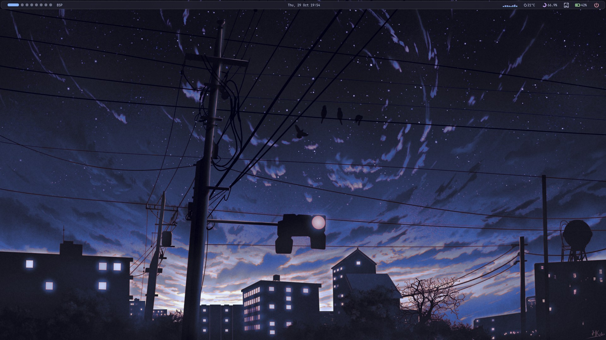
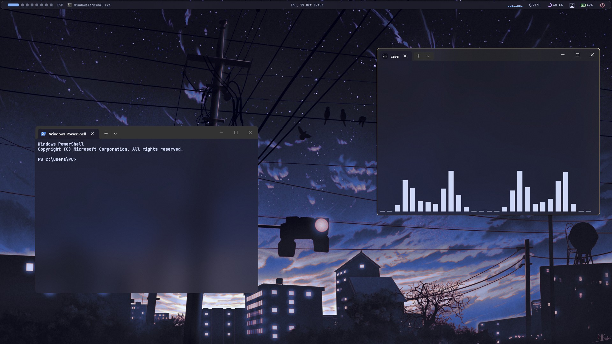
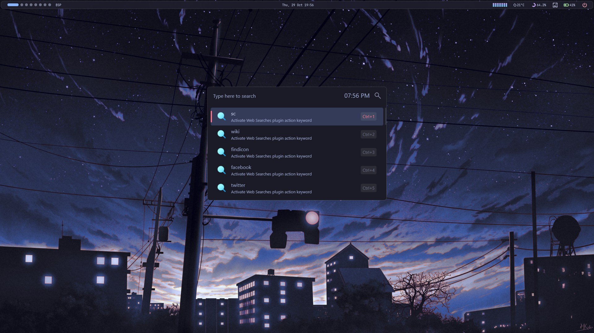
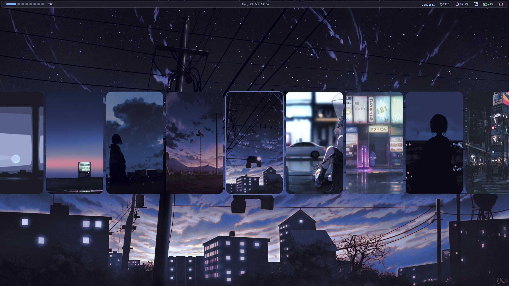

# My Windows 11 Setup :

A complete guide to my Windows 11 customization. From the YASB bar to all the little tweaks that make it clean and productive.

  
  
   
  
  

## 📄 Table of Contents

| 🏷️ Name | ✨ Source |
| :--- | :--- |
| Status Bar | [YASB](https://github.com/amnweb/yasb)[cite: 3] |
| Window Manager | [Komorebi](https://github.com/LGUG2Z/komorebi)[cite: 3] |
| Focus Follows Mouse | [Masir](https://github.com/LGUG2Z/masir) |
| App Launcher | [Flow Launcher](https://github.com/Flow-Launcher/Flow.Launcher)[cite: 3] |
| Mouse Cursors | [Windows 11 Cursors Concept](https://vsthemes.org/en/cursors/black/36701-windows-11-cursors-concept.html) |
| Text Editor | [VSCode](https://code.visualstudio.com/)[cite: 3] |
| Terminal | [Windows Terminal](https://github.com/microsoft/terminal)[cite: 3] |
| Audio Visualizer | [Cava](https://github.com/karlstav/cava)[cite: 3] |

---

## ⚡ Details

### 🖱️ Mouse Cursors

A clean, modern custom cursor pointer concept that elevates the desktop look.

⚙️ **Installation:**
* Download the pack from [VSThemes](https://vsthemes.org/en/cursors/black/36701-windows-11-cursors-concept.html).
* Unzip the archive, right-click the `Install.inf` file, and select **Install**.
* Go to Windows Settings > Bluetooth & devices > Mouse > Additional mouse settings > **Pointers** tab, select the scheme, and click **Apply**.

### 📉 YASB

> [!NOTE]
> Some stuff in my config might not work if you just copy and paste it. Be sure to add your own API key for the weather widget to work, and update your folder paths.

A highly configurable Windows status bar written in Python.

⚙️ **Installation:**
* Install **YASB**.
* Download my config files from the `/YASB` folder in this repo.
* Replace the code in your local YASB config with the ones you just copied.
* Restart **YASB** for the changes to take effect.

### 🪟 Komorebi + Masir

> [!NOTE]
> Masir is used here to enable "focus follows mouse" behavior seamlessly with Komorebi's tiling management.

Komorebi lets you easily organize windows and adjust their layout on the fly by using keyboard-driven commands.

⚙️ **Installation:**
* Install **Komorebi** and **Masir**.
* Copy the `komorebi.json` file from here to your `C:\Users\YOUR_NAME\` directory.
* Restart **Komorebi** for the changes to take effect.

---

## 📺 Credits & Helpful Resources

A huge thanks to the following creators and repositories that inspired this setup and helped me piece everything together:

* **[SleepyCatHey](https://www.youtube.com/@SleepyCatHey)** - For the amazing visual inspiration and configuration ideas on YouTube.
* **[SleepyCatHey / Ultimate-Win11-Setup](https://github.com/SleepyCatHey/Ultimate-Win11-Setup/tree/main)** - Used as a major reference for structuring these dotfiles and organizing the layout.
* **[MrDLingters / Win11TokyoNight](https://github.com/MrDLingters/Win11TokyoNight/tree/main)** - A fantastic Windows customization repository that helped shape this setup.
* **[Windows Ricing Guide (by darrenlingters3512)](https://www.youtube.com/watch?v=9RJre4byy2g&t=2236s)** - This complete installation tutorial was incredibly helpful for learning how to install and configure tools like Komorebi, Masir, and YASB from scratch.
